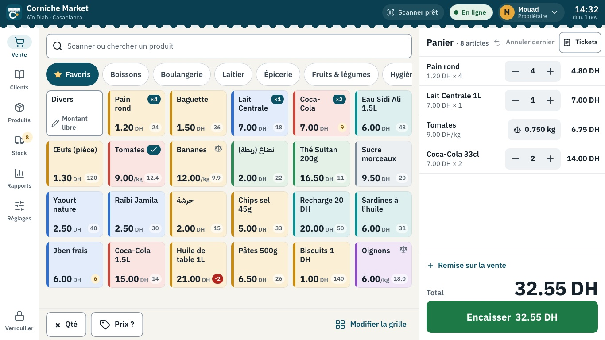
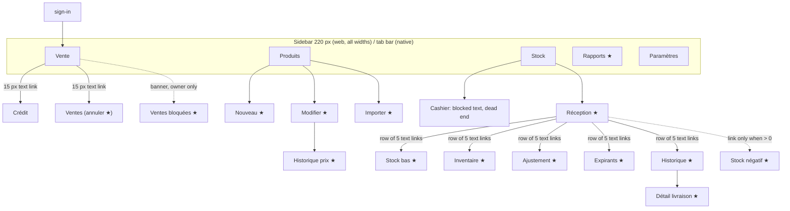
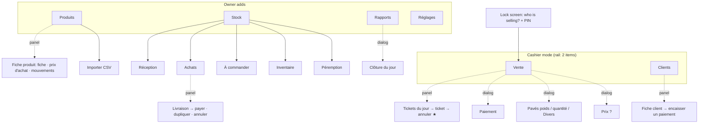
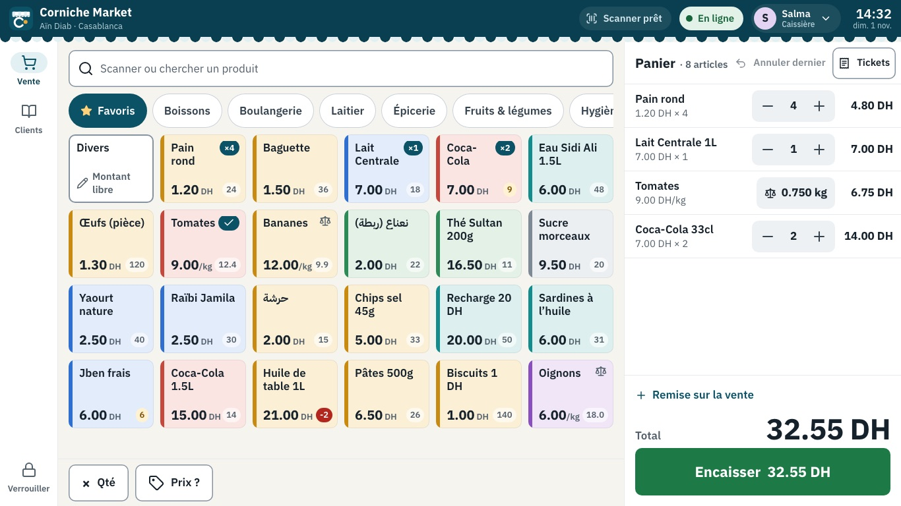
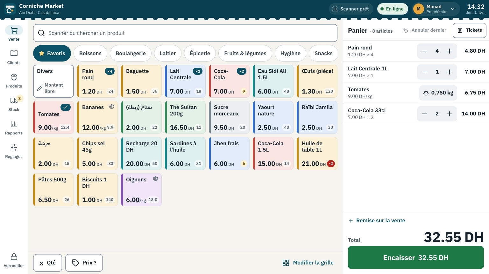
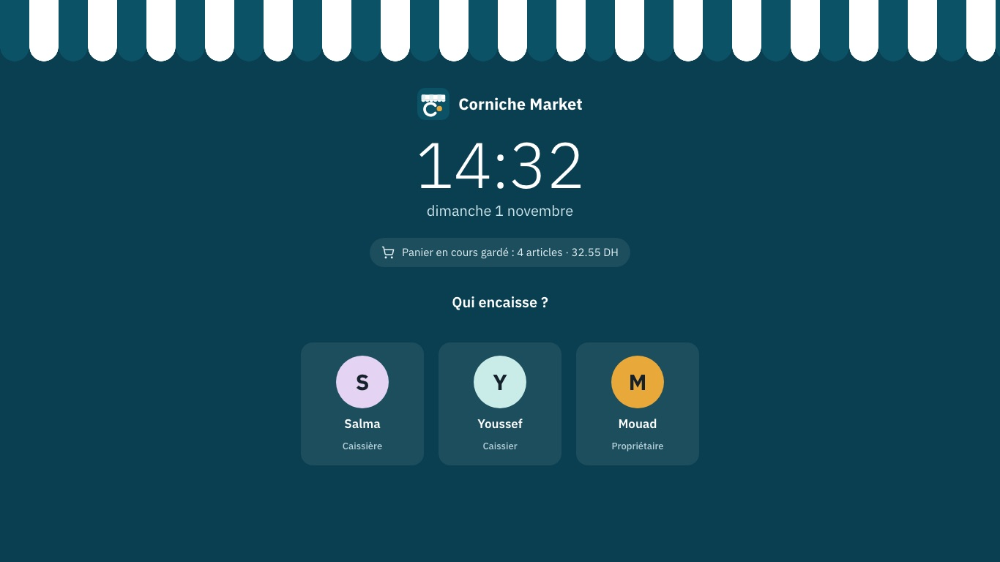
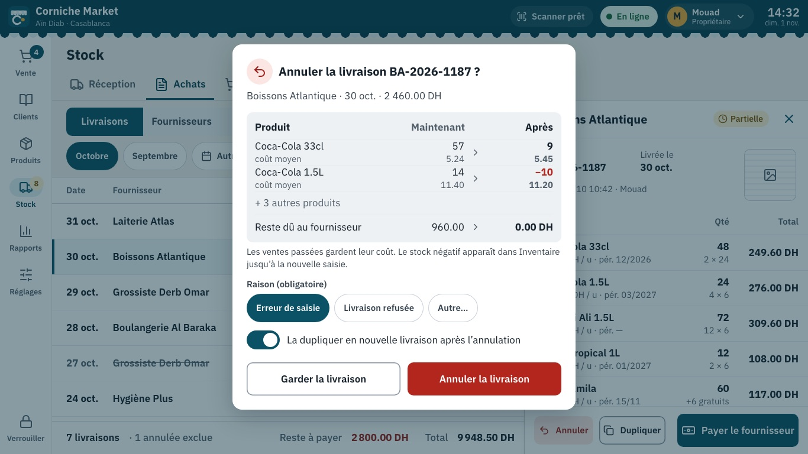

# Corniche Market: structure, theme and POS shell

Status: design proposal. No app code changed. Written 2026-11-01 against `main` at `0d0ec70` (through PR #19).

This builds on three earlier documents and does not repeat them:

- `docs/UI-REVIEW.md` (branch `review/ui`): screen-by-screen findings and a first design-system sketch. This doc **finalizes** that sketch and changes a few of its values (listed in 2.2 and 2.3).
- `docs/SELL-GRID-DESIGN.md` (branch `design/sell-grid`): the Sell grid, pads, Divers and the touch-only laptop rules (2.7.2). Not redesigned here. This doc puts the grid inside the new shell and styles it.
- `docs/STOCK-IN-DESIGN.md` (branch `design/stock-in`): receiving, voiding and purchase history. Not redesigned here. This doc gives those screens their place in the structure and their look.

**Prototype.** Open `docs/prototype/index.html` in a browser. No server or build step. It has every screen asked for, owner and cashier, French and Arabic, at 1366×768, plus the tablet Sell and a 1536×864 view. A bar above the device frame switches language, role, network state and screen state. 44 screenshots are in `docs/prototype/screenshots/` (index in Appendix A).



---

## Summary: the decisions in this doc

1. **Organize by daily jobs, not by tables.** Six sections for the owner (Vente, Clients, Produits, Stock, Rapports, Réglages). A cashier sees two: **Vente and Clients**. That is "cashier mode": selling, credit, nothing else.
2. **One POS shell on every screen**: a dark top bar (store, scanner, sync, who is at the till, clock) with the shop's striped awning under it, and a navigation rail (laptop, tablet) or bottom tabs (phone).
3. **Three surfaces, fixed rules**: full page for a section or a long job, docked panel for one record from a list, dialog for a decision or a short entry. One primary action per surface, always at the bottom end corner.
4. **19 app screens become 11 pages and 6 panels.** Credit becomes the Clients section, sales history becomes a Tickets panel inside Vente, stuck sales move to the sync menu, product new/edit/history become one product panel, and adjust/count/negative stock become one Inventaire page.
5. **Brand colour moves from green to "Atlantique" blue.** Green is kept for one meaning only: money coming in (Encaisser, paid, profit up). Red means money going out or something destructive.
6. **IBM Plex Sans + IBM Plex Sans Arabic**, bundled offline, tabular figures for every number, a type scale sized for reading at arm's length (body 17 px, basket total 44 px), one step larger in Arabic.
7. **An in-app dialog replaces `window.confirm` and `Alert.alert`.** Destructive dialogs show what will change, before and after.
8. **Light theme only for launch.** A dark/evening theme is not worth it yet (2.6).
9. **Shared devices lock after 3 minutes idle**; the next person picks their name and types a PIN. The basket is kept.
10. **Efficiency additions ranked** (3.6): undo last scan, faster startup, forgiving search and an end-of-day summary before launch; WhatsApp receipt, low-stock alerts, reorder via WhatsApp, own barcode labels and a receipt printer after; "recently sold" row: no.

---

## Part 1: Structure

### 1.1 What exists today

19 screens inside the app plus 4 outside it (sign-in, accept-invite, a loading redirect, not-found). Navigation is a 220 px sidebar on web at every width and a bottom tab bar on native.



★ = owner only.

| Role | What they can reach today |
|---|---|
| Owner | Everything above. |
| Cashier | Vente (cart, Crédit, Ventes without void), Produits as a read-only list (no cost, no actions), a Stock tab that only shows "reserved for the owner", Paramètres with account and language. Rapports is hidden. |

Structural problems (the visual ones are in `UI-REVIEW.md`):

- **Daily jobs are hidden behind 15 px text links.** Credit is a daily job in a corner shop (the *carnet*), yet it sits as a small link in the Sell header. So does the sales history.
- **The cashier has a dead end** (the Stock tab) and a screen they don't need (a read-only Products list, used only to check a price).
- **Stock is a hub of five text links** plus a sixth that appears only when stock is negative. Adjust, count and negative stock are three screens for one job: make the numbers match the shelf.
- **Product new / edit / price history are three full pages**, so the owner loses the list each time.
- **Stuck sales are reachable only from a banner on Sell**, for the owner only, and the screen redirects away before it paints (UI-REVIEW, Sell).
- **No sense of "who is at the till".** Handing over the counter means signing out and typing an email and password on a touch screen.

### 1.2 Proposed: sections by daily job

| Daily job | Who | How often | Proposed place | Today |
|---|---|---|---|---|
| Ring up a basket | cashier, owner | 150 to 300 a day | **Vente** | Vente |
| Check a price without selling | cashier | many a day | Vente → **Prix ?** dialog | Products list or Sell search |
| Sell on credit, take a credit payment | cashier, owner | 10 to 30 a day | Vente (payment) and **Clients** | small "Crédit" link |
| Resend, reprint or void a ticket | cashier (void: owner) | a few a day | Vente → **Tickets** panel | small "Ventes" link |
| Hand over the counter | everyone | 2 to 4 a day | **Lock screen + PIN** | sign out, sign in |
| Receive a delivery | owner | 3 to 10 a week | **Stock → Réception** | Stock |
| Check invoices, pay a supplier | owner | weekly | **Stock → Achats** | history without detail |
| Decide what to reorder | owner | weekly | **Stock → À commander** | "Stock bas" link |
| Count, correct, write off | owner | weekly to monthly | **Stock → Inventaire** | 3 screens |
| Pull expiring goods | owner | weekly | **Stock → Péremption** | "Expirants" link |
| Add products, change prices | owner | weekly | **Produits** | Produits |
| See how the day went, close the day | owner | daily | **Rapports** (home) + **Clôture du jour** | one long page, no close |
| Team, device, backup | owner | rarely | **Réglages** | Paramètres |



What is on each section:

| Section | Owner | Cashier |
|---|---|---|
| **Vente** | Grid and cart (SELL-GRID-DESIGN), × Qté, Prix ?, undo last, Tickets panel (all cashiers, any day, void), Modifier la grille. | Same, minus Modifier la grille. Tickets panel shows **their own tickets today**; void shows "only the owner can cancel a sale". |
| **Clients** | Customer list with balances, search, filters (owe / settled / all), customer panel: balance, history, encaisser un paiement, send balance on WhatsApp, edit, delete. | Same list and panel. Can add a customer and record a payment (today's RLS already allows both). Cannot edit or delete. |
| **Produits** | Table (name, barcode, category, stock, average cost, price, margin), filters, product panel, Plus menu: import, export, bulk price, labels. | Not shown. Price check lives in Vente. |
| **Stock** | Sub-tabs: Réception, Achats, À commander, Inventaire, Péremption, each with a count badge. | Not shown (STOCK-IN-DESIGN decision Q1: owner-only receiving). |
| **Rapports** | Home: profit first, revenue, tickets, margin, 7-day chart, "À faire" list, top products, categories, hours. Clôture du jour dialog. Export. | Not shown. |
| **Réglages** | Store, team and PINs, sale and Divers settings, tickets and WhatsApp, this device, language, backup, account. | Not a rail item. Language, "change cashier", "lock" and "my sales today" are in the account menu under their name in the top bar. |

**Cashier mode** is not a separate app. It is the same shell with two rail items and fewer actions, decided by `useAuth().isOwner` as today. The rule from CLAUDE.md holds at every layer: no cost or profit on any screen a cashier can open.



### 1.3 The POS shell

```
┌──────────────────────────────────────────────────────────────────────────────────────┐
│ [▣] Corniche Market          [▮▮ Scanner prêt] [● En ligne] [(S) Salma ▾]   14:32     │ 56 px top bar
│     Aïn Diab · Casablanca                                     Caissière    dim. 1 nov.│ brand-800
╰◡◡◡◡◡◡◡◡◡◡◡◡◡◡◡◡◡◡◡◡◡◡◡◡◡◡◡◡◡◡◡◡◡◡◡◡◡◡◡◡◡◡◡◡◡◡◡◡◡◡◡◡◡◡◡◡◡◡◡◡◡◡◡◡◡◡◡◡◡◡◡◡◡◡◡◡◡╯ 8 px awning
│ (🛒)  │                                                                              │
│ Vente │                                                                              │
│  📖   │                      page                                                    │
│Clients│                                                                              │
│  📦   │                                                                              │
│Produits                                                                              │
│  🚚 8 │                                                                              │
│ Stock │                                                                              │
│  📊   │                                                                              │
│Rapports                                                                              │
│  ⚙    │                                                                              │
│Réglages                                                                              │
│       │                                                                              │
│  🔒   │                                                                              │
│Verrou.│                                                                              │
└───────┴──────────────────────────────────────────────────────────────────────────────┘
 88 px rail
```

**Top bar (56 px, always the same).** From the start edge: the Corniche mark and store name with its location; then, at the end: the scanner state (laptop only), the sync pill, the person at the till, and the clock. The section name is not repeated here (the rail shows it, each page has its own title), so the bar never changes and the cashier learns one place to look.

| Element | States | Tap does |
|---|---|---|
| Scanner pill | "Scanner prêt" | nothing (status only); shown only where a USB scanner is used |
| Sync pill | green "En ligne", amber "Hors ligne · 3 en attente", red "1 vente bloquée" | opens the sync menu: pending and stuck sales, last price refresh, "Synchroniser maintenant"; owner gets retry and export (replaces `sell/stuck`) |
| Person chip | avatar, first name, role | account menu: language, change cashier, lock now, my sales today (cashier), Réglages and "disconnect this device" (owner) |
| Clock | HH:MM, short date | nothing. Real time, store timezone |

**Rail (88 px).** Items are 72 px tall: a 24 px icon over a 13 px label (14 px in Arabic). The active item gets a brand-100 pill behind the icon. Badges: Vente shows the basket count when you are elsewhere (the basket is never lost by leaving), Stock shows how many things need attention (low + negative + expiring). **Verrouiller** is pinned at the bottom, where the hand rests on a counter.

**Per device.**

| | Touch laptop 1366×768 | Touch laptop 1920×1080 | Android tablet 1280×800 | Phone |
|---|---|---|---|---|
| CSS size used | 1366×768 (100 %) | **1536×864 at 125 % scaling (recommended)**; must still work at 1280×720 (150 %) | 1280×800 dp | 360 to 412 × 800 dp |
| Navigation | rail 88 | rail 88 | rail 88 | bottom tabs 64 dp (owner: Vente, Clients, Produits, Stock, Plus; cashier: Vente, Clients) |
| Sell | grid (6 columns) + cart 420 | grid (7 columns) + cart 460 | grid (5 columns) + cart 420, camera panel on top of the cart | grid (3 columns) + collapsible cart bar (SELL-GRID 2.7) |
| Panels | docked 480 at the end edge, list shrinks | docked 520 | docked 480 | full screen with a back arrow |
| Scanner | USB keyboard wedge, listening on every screen (3.3) | same | camera (SELL-GRID 2.7.1) | camera |
| Typing | in-app keyboard (SELL-GRID T3) | same | Android keyboard | phone keyboard |

Why 125 % on the 1920×1080 laptop: at 100 % a 48 px target is about 8.6 mm on a 15.6" panel, too small for a fast thumb. Windows defaults most 1920×1080 laptops to 125 % or 150 %, which gives the page 1536×864 or 1280×720 CSS pixels. The layout is designed at 1366×768, checked at 1536×864 (screenshot 42) and at 1280×720 (screenshot 44), where the Sell grid still shows 3 full rows of tiles and the cart about 6 lines.



### 1.4 Conventions

**Which surface.**

| Surface | Use it for | Examples | Never for |
|---|---|---|---|
| **Full page** | A section root, or a job with its own save that needs the whole screen | Vente, Réception, Inventaire (count), Importer | a single record from a list |
| **Docked panel** (end edge, 480 px) | Viewing or editing one record picked from a list. The list stays visible and usable; tapping another row swaps the panel. | ticket, client, product, delivery, supplier | multi-step jobs |
| **Dialog** (centred, modal) | A decision, or a short entry that must be finished or cancelled | payment, weight/quantity/Divers pads, Prix ?, confirm destructive, PIN, Clôture du jour | browsing |
| **Popover** | Menus from a button | account, sync, Produits → Plus | anything with a save |
| **Toast** (top centre, 5 s, one at a time) | Something just happened, with at most one follow-up action | "Vente enregistrée · 32.55 DH [WhatsApp] [Imprimer]", "Retiré : Pain rond [Annuler]" | errors that need action |
| **Banner** (inside the page) | A state that lasts | offline with price age, backup overdue, incomplete delivery lines | one-off confirmations |
| **Inline message** | Field validation, next to the field | "Le montant dépasse 200.00 DH" | page-level failures |

The pads (weight, quantity, Divers, price check) open **over the grid only**: the cart stays visible beside them so the cashier sees the line appear (screenshot 04).

**Where the primary action lives.**

- One primary action per page, panel or dialog, at the **bottom end corner** of its container (bottom right in French, bottom left in Arabic): Encaisser at the foot of the cart, Enregistrer in a panel footer, Confirmer at the end of a dialog. The way out (Annuler, Garder, Retour) sits on the start side of the same row.
- Creating something new ("Nouveau produit", "Nouveau client") is the one exception: it lives at the end of the **page header**, because it is not the commit of a form.
- **Green buttons take money in**: Encaisser, Valider (payment), Encaisser un paiement (credit). Every other primary is Atlantique blue. A red button is never the primary of a page: destructive actions are soft-red buttons on the start side and always go through the confirm dialog.

**How to go back.** There is no browser back button in kiosk mode, so the app never relies on it.

- The rail switches sections. Each section remembers its sub-tab, filters and scroll position.
- A panel closes with ✕ at the end of its header. A drill-in inside a panel (ticket list → one ticket) shows a back chevron at the start of the header.
- A full sub-page (Importer, an Inventaire count) has "← Retour" at the start of its header and asks before throwing away unsaved work.
- Android back closes the top layer first: dialog, then panel, then popover. On a section root it does nothing.
- Dialogs close with their cancel button or a tap on the scrim, except destructive dialogs, which close only through a button.

**RTL.** Layout uses start/end everywhere, so Arabic mirrors without special cases. What does not mirror: keypads and steppers, numbers and amounts (LTR islands, `isolateBidi`), barcodes, the clock, chart time axes, and non-directional icons. Directional icons (back, chevron, undo, log-out, message tail) flip.

### 1.5 Cut or merge

| Today | Proposal | Why |
|---|---|---|
| `sell/history` | **Tickets panel** in Vente | It is part of selling; as a panel the cart stays in view. |
| `sell/stuck` | **Sync menu** from the top-bar pill | The status is shown on every screen, so its detail is reachable from every screen, not only from a banner on Sell. |
| `sell/credit` | **Clients** section | A daily job deserves a rail item and a real list with search. |
| `products/new`, `products/[id]`, `products/history/[id]` | **Product panel** with tabs Fiche, Prix d'achat, Mouvements | One place per product; the list stays visible. |
| Products list for cashiers | **Cut.** Prix ? dialog in Vente | Cashiers only need price and stock. One less screen to keep cost-free. |
| Stock hub's row of text links | **Sub-tabs with badges** | Discoverable, and counts say where to look. |
| `stock-in/low-stock` | **À commander** | Name the job, not the data. |
| `stock-in/adjust`, `stock-in/count`, `stock-in/negative-stock` | **Inventaire**: one page with "Compter", "Corriger / perte" and a "Stock négatif" filter | One job: make stock match the shelf. (`count.tsx` keeps T02's logic.) |
| `stock-in/history`, `stock-in/delivery/[id]` | **Achats** + delivery panel | As STOCK-IN-DESIGN 3.1, in the panel pattern. |
| Stock tab for cashiers | **Removed** from the cashier rail | No dead ends. |
| Rapports as one long page | **Home** with the decision numbers + **Clôture du jour**; the long tables move behind "Voir tout" | Profit first and actionable (UI-REVIEW asked for profit priority). |
| Paramètres as one scroll | **Master-detail** groups | It is about to grow: team, PINs, device, Divers, receipts. |
| Sign out / sign in to switch cashier | **Lock screen + PIN** (3.5) | Shared counter. |

Result: 11 pages (Vente, Clients, Produits, Importer, 5 Stock tabs, Rapports, Réglages) and 6 panels (tickets, sync, client, product, delivery, supplier), instead of 19 screens.

---

## Part 2: Theme

### 2.1 Visual identity: "l'auvent de la Corniche"

The idea is the shop's own awning on the seafront: blue and white stripes with a scalloped edge, over the Atlantic, in the sun. It is specific to a corner shop on the Corniche, and it costs almost nothing to build.

- **The mark.** A rounded blue square with a striped, scalloped awning across the top, a white "C" that doubles as the curve of the bay, and a sand-coloured sun inside it. Used for the app icon, the PWA icon, the favicon, the lock screen and the printed ticket header. (Prototype: `brandMark()` in `assets/icons.js`.)
- **The signature.** An 8 px scalloped valance under the top bar, in two blues, on every screen; the full striped awning across the top of the lock screen and splash.
- **Where decoration stops.** Work surfaces (grid, cart, tables, forms) stay plain: white cards on a warm sand-white background, no patterns, no gradients, no photos. The identity lives in the shell, the lock screen and the receipt. No zellige wallpaper: it would fight the tiles for attention.
- **Voice.** Short, polite, counter words: "Encaisser", "À rendre", "Le carnet", "Annuler dernier". Arabic follows Moroccan usage where the user reads it daily (month names نونبر, دجنبر), and the store vocabulary is a question for you (Q10).



### 2.2 Colour

All ratios are computed with the WCAG 2.1 relative-luminance formula, not estimated. AA needs 4.5:1 for normal text, 3:1 for large text and for the outline of a control.

**Brand and neutrals**

| Token | Hex | Use | Contrast |
|---|---|---|---|
| `brand.800` | `#093f50` | top bar, pressed primary | white on it 11.4:1 |
| `brand.700` | `#0b5266` | primary button, active nav, links | white on it 8.7:1; on surface 8.7:1; on bg 7.9:1 |
| `brand.600` | `#0e6680` | focus ring, chart bars | white on it 6.5:1 |
| `brand.100` | `#e3f0f3` | selected chip, active rail pill, info background | brand.700 on it 7.5:1; ink.900 14.0:1 |
| `sand.500` | `#e9a93a` | identity only: logo sun, favourites star, avatar | ink.900 on it 7.9:1. Never white text, never a state. |
| `ink.900` | `#15212b` | primary text | 16.4:1 on surface, 14.9:1 on bg |
| `ink.700` | `#35434f` | strong secondary text | 10.2:1 |
| `ink.600` | `#52606c` | secondary text, meta | 6.5:1 on surface, 5.9:1 on bg, 5.6:1 on brand.100 |
| `ink.400` | `#8592a0` | input and button outlines, placeholders' icons | 3.2:1 on surface (passes 1.4.11 for outlines). Never text that matters. |
| `border` | `#c9d1d8` | card and table borders | decorative |
| `bg` | `#f6f4ef` | app background (warm sand-white) | |
| `surface` | `#ffffff` | cards, panels, inputs | |
| `sunken` | `#eef1f3` | wells: search, steppers, keypad body | ink.600 on it 5.7:1 |

**Semantic**

| Token | Hex | Meaning | Contrast |
|---|---|---|---|
| `success.700` / `.600` / `.100` | `#16653a` / `#1d7a46` / `#e2f2e8` | money in, paid, synced, profit up | white on .600 5.4:1; .700 on .100 6.1:1; .700 on surface 7.1:1 |
| `danger.700` / `.600` / `.100` | `#9a1f18` / `#b3261e` / `#fbe6e4` | destructive, negative stock, loss, error | white on .600 6.5:1; .600 on surface 6.5:1; .700 on .100 6.8:1 |
| `warning.700` / `.500` / `.100` | `#7a4f00` / `#d99a1e` / `#fff2d3` | needs attention soon: low stock, offline, partial, incomplete | .700 on .100 6.4:1; .700 on surface 7.1:1 (.500 is for icons and borders only) |
| `info` | = brand.700 / brand.100 | neutral information | as brand |
| `disabled.bg` / `.fg` | `#e1e5e8` / `#4f5b66` | disabled controls: solid, not faded | 5.5:1 (UI-REVIEW #1 fixed at the token level) |

Rules:

- **Money up / down**: green with "+" or ▲, red with "−" or ▼. Always a sign. Colour is never the only signal (colour-blind owners, sunlight).
- **Status pills**: always an icon and a word ("✓ Payée", "◷ Partielle", "△ Impayée", "✕ Annulée").
- **Pills on the dark top bar** use the `.100` tints with `.700` text: 9.5 to 10.3:1 against the bar.
- **Tile palette** (the 8 keys from SELL-GRID 2.2): a light tint for the tile and a 6 px strip on the start edge. ink.900 on every tint is 13.5 to 14.3:1. Values in `assets/tokens.css`.

Changes from the UI-REVIEW sketch, and why:

| UI-REVIEW | Now | Why |
|---|---|---|
| brand = green `#1d7a46` | brand = Atlantique `#0b5266`; green kept for money in | With a green brand, the Encaisser button, "profit up", "paid" and every ordinary Save button were the same colour. A POS needs "green = money comes in" to mean exactly that. Blue is also the identity (2.1). |
| bg `#f2f2f2` | `#f6f4ef` | Warmer and calmer under shop lighting; white cards still separate clearly. |
| grey `#5c5c5c` secondary | blue-tinted `#52606c` | Same contrast class (6.5:1), sits better with the blue brand. |
| input border `#d8d8d8` | outline `#8592a0` | `#d8d8d8` is 1.4:1: inputs disappear in daylight. 3.2:1 passes WCAG 1.4.11. |
| warning `#8a5a00` | `#7a4f00` | Slightly darker so it also passes on the warning tint (6.4:1). |

### 2.3 Typography

**Recommendation: IBM Plex Sans (Latin) + IBM Plex Sans Arabic.**

- They are one family: same weights (100 to 700), matched vertical metrics and stroke contrast, so a French product name next to an Arabic label sits on the same line without jumping.
- Plex Sans has true tabular figures and clear 1/l/I and 0/O shapes, which matters for prices, quantities and barcodes.
- Plex Sans Arabic is a clean, low-contrast sans that stays legible at 15 to 18 px on a screen, without the calligraphic detail that blurs at a distance.
- Open licence (SIL OFL). **Bundle the files** with the app (`expo-font`), never load them from a CDN: the app must start offline. Three weights per script (400, 600, 700) plus 300 for the lock-screen clock, subset to Latin + Arabic: roughly 0.5 MB in total.

Considered and not chosen: Noto Sans + Noto Sans Arabic (safe but generic, larger files); Cairo or Tajawal (Arabic-first, but their Latin and digits are weaker for prices); Inter + Noto Kufi Arabic (excellent Latin, mismatched pair).

**Numbers.**

- Western digits 0 to 9 in every language, as on Moroccan price tags and receipts.
- Tabular figures (`font-variant-numeric: tabular-nums`) on every amount, quantity, time and count, so columns line up and totals don't shimmer as they change.
- Amounts are LTR islands inside Arabic text: "32.55 DH" always reads the same. One `<Money>` component does `formatMAD` + isolation + tabular figures, so no screen can forget.
- Keep "." as the decimal separator (the app's current format). Add a narrow no-break space for thousands: "3 482.50 DH" instead of "3482.50 DH" (Q9).

**Scale** (for a 50 to 70 cm reading distance; Arabic is one step larger for running text, numbers unchanged):

| Token | Latin | Arabic | Weight | Use |
|---|---|---|---|---|
| `meta` | 13 | 14 | 600 | badges, timestamps (never the only carrier of meaning) |
| `caption` | 15 | 16 | 400/600 | secondary lines, table meta, helper text |
| `body` | 17 | 18 | 400/600 | default text, buttons, table cells, tile names |
| `subtitle` | 20 | 21 | 600/700 | section and panel titles, tile prices |
| `title` | 24 | 25 | 700 | page titles |
| `kpi` | 32 | 32 | 700 | report figures, change to give |
| `total` | 44 | 44 | 700 | basket total, price check |

Line height 1.35 for Latin, 1.55 for Arabic. Product names: 2 lines on a tile, 1 line with an ellipsis in the cart, full in the panel. The UI-REVIEW sketch had body at 15 px; 17 px is the right size for a counter screen read standing up.

### 2.4 Space, shape, size

- **Spacing**: base 4 → 4, 8, 12, 16, 24, 32, 48. Page edges 24, card padding 16, gaps 8 or 12.
- **Two radii**: 10 px for controls (buttons, inputs, chips' corners, keys, tiles), 16 px for containers (cards, panels, dialogs). Pills (chips, badges, status) are fully round: a shape, not a third radius.
- **Touch sizes**: 48 px minimum everywhere; 56 px for default buttons, inputs and list rows; 64 px for keypad keys and tiles; 72 px for the one Encaisser button.
- **Elevation**: flat. One soft shadow for cards and panels, one deeper for dialogs and popovers. Nothing else.
- **Motion**: 120 ms for taps and toggles, 200 ms for panels and toasts, none at all when the OS asks for reduced motion.
- **Breakpoints**: rail and docked panels from 900 dp; below that, bottom tabs and full-screen panels. Larger cart and panel from 1500 px.

### 2.5 Components

Each one exists in the prototype (`docs/prototype/assets/app.css`) with the same names the build plan uses.

**Buttons**

| Variant | Look | Use |
|---|---|---|
| `primary` | brand.700, white text | the commit action of a page, panel or dialog |
| `pay` | success.600, white, 72 px tall, 22 px text | money in: Encaisser, Valider, Encaisser un paiement |
| `secondary` | white, 1.5 px ink.400 outline | everything else that matters |
| `quiet` | text only, brand.700 | low-emphasis actions: "Remise sur la vente", "Annuler dernier" |
| `danger` | danger.600, white | only inside a confirm dialog |
| `dangerSoft` | danger.100, danger.700 text | destructive entry points: Retirer, Annuler la vente |
| disabled | solid disabled.bg, disabled.fg text (5.5:1) | never opacity |

Sizes: 48 (small), 56 (default), 72 (pay). Icon + label, icon on the start side. Icon-only buttons are 48×48 and always have an accessible label.

**Tile** (grid). 124 px minimum width, 104 px tall, 10 px radius, tint + 6 px start strip. Name 17/600 on 2 lines; price 20/700 at the bottom start ("DH" or "/kg" small); stock badge at the bottom end (amber when low, red at zero or below, still tappable); "×N" brand badge floated at the top end when in the cart, a check for weighed lines; scale icon for kg products. Divers: white with a 2 px outline and "✎ Montant libre". Pressed: scales to 96 % with a brand ring.

**Card.** White, 16 px radius, 16 px padding, soft shadow. Title in caption/700.

**Table and list row.** Header 44 px, rows 60 px (68 px for list rows with an avatar), 24 px start padding. Number columns end-aligned with tabular figures. Selected row: brand.50 background and a 4 px brand bar on the start edge. Voided rows: grey, struck through, with an "Annulée" pill. A footer row carries the count and totals of the filtered set.

**Panel.** 480 px (520 at ≥1500 px), docked at the end edge, 64 px header with title and ✕, scrolling body, footer with the primary action at the end and a destructive entry at the start.

**Dialog.** Centred, max 480 px (wider for payment and pads), 16 px radius, scrim `rgba(7,47,60,.48)`. Title with an optional round icon, body, then actions: cancel on the start side, confirm at the end, both full-width halves.

**Confirm dialog (replaces `window.confirm` and `Alert.alert`).** `src/lib/confirmDestructive.ts` uses `window.confirm` on web and `Alert.alert` on native today; Settings uses `Alert.alert` for the language change. Both are replaced by one promise-based call rendered by a `DialogHost` in the shell, identical on web and native:

```ts
const ok = await confirm({
  tone: "danger",
  title: t("sell.voidConfirmTitle", { no: "0185" }),
  summary: "34.50 DH · 14:09 · Salma · crédit Fatima Zahra B.",
  consequences: [
    { label: t("sell.voidStockBack"), after: "10 articles" },
    { label: t("credit.customerBalance"), before: 24550, after: 21100 },
    { label: t("reports.todaySales"), before: 348250, after: 344800 },
  ],
  reason: { required: true, options: ["till_error", "returned", "other"] },
  confirmLabel: t("sell.voidAndRestore"),   // the verb, never "OK"
  cancelLabel: t("sell.keepSale"),          // what you keep, never "Cancel"
});
// keys other than sell.voidConfirmTitle / sell.voidAndRestore are new (added in fr, en, ar together)
```

Destructive dialogs cannot be dismissed by tapping the scrim, put the red button at the end, and say what will change, before and after (STOCK-IN-DESIGN 2.1.1 already asks for this on voiding a delivery). Screenshots 08 and 13.



**Toast.** Ink.900 background, white text, a green check, at most one action, top centre under the top bar so it never covers the cart total or the pay button. 5 seconds; a new toast replaces the old one. Screen readers get it as a polite status.

**Keypad and in-app keyboard.** Phone layout (7-8-9 on top), 64 px keys, 10 px radius, a bottom border to look pressable, never mirrored. Presets above the keypad add immediately (SELL-GRID 2.3). The in-app keyboard (SELL-GRID T3) uses the same key component: AZERTY in French, Arabic layout in Arabic, 56 px keys, docked over the grid so the cart stays visible (screenshots 07 and 30).

**Badges and status pills.** Count badges are 24 px round, tabular. Status pills are 28 px, icon + word, in the semantic tints.

**Tabs, chips, segmented control.** Tabs navigate between sibling views (52 px, 3 px brand underline). Chips filter (48 px pills, filled brand when on). The segmented control picks one mode inside a form or panel (48 px, filled brand segment).

**Inputs.** 56 px, 10 px radius, ink.400 outline, focus = 2 px brand.600 ring plus a soft halo. Number inputs are end-aligned with tabular figures and open a keypad on touch devices. Dates are chips ("Aujourd'hui", "Hier", "Autre…") or a day/month/year stepper, never a free-text field (STOCK-IN-DESIGN 2.13).

**Empty, error and offline states.** One pattern: round icon, title, one sentence, at most one action.

| State | Example |
|---|---|
| Empty | "Personne ne doit d'argent. Les ventes à crédit apparaîtront ici." |
| First run (0 products) | "Commencez par ajouter vos produits" + [Ajouter] [Importer] (already shipped in PR #17, restyled) |
| Load failed | "Impossible de charger les clients. Vérifiez la connexion." + [Réessayer] (UI-REVIEW #4's shared component) |
| Offline, Sell | sync pill amber + banner "Hors ligne · prix du 14:20"; selling continues |
| Offline, owner job | "Connexion requise pour enregistrer la livraison. Votre brouillon est gardé sur l'appareil." |

**Icons.** Lucide (ISC licence, `lucide-react-native`): 24 px, 2 px rounded strokes, one family everywhere. The prototype uses 62 (list in `assets/icons.js`). Directional icons flip in Arabic; the rest never do. Icons always come with a label, except well-known controls (✕, ⌫, search) which carry an accessible label instead.

### 2.6 Dark or evening theme: not now

Not worth it for launch, and probably not after.

- The shop is lit at night; the screen competes with shop lights, not darkness. In daylight near the door, a light theme wins on glare.
- It doubles visual QA (every screen, FR/AR, owner/cashier, two themes) for a small team.
- The tokens are semantic (`surface`, `ink.900`, `success.700`), and SELL-GRID already chose tile colours that work on dark, so adding it later is about two PRs if cashiers ask.
- Cheaper answer for late evenings: the OS night light, and the lock screen, which is already dark.

---

## Part 3: POS efficiency

### 3.1 Full screen and kiosk

- **Laptop**: install the web app as a PWA (manifest and service worker: SELL-GRID T2) in Edge or Chrome, `display: fullscreen`, start URL `/sell`, landscape. Set it to start with Windows. Windows display scaling 125 % on a 1920×1080 panel (1.3). The owner leaves full screen from Réglages → Cet appareil, so no keyboard shortcut is needed.
- **Tablet**: Android screen pinning (or a kiosk launcher if the owner wants it locked harder), landscape (already shipped in PR #18), screen kept awake on Vente (PR #18).
- **No accidental browser behaviour** (pinch, double-tap zoom, text selection, long-press menu, pull to refresh): SELL-GRID 2.7.2 item 5, applied to the whole shell, not only Sell.

### 3.2 Touch only

SELL-GRID 2.7.2 sets the rules for Sell. This doc extends them to every screen:

- Every text field that a cashier or owner uses at the counter gets the in-app keyboard in touch-only mode: Sell search, customer search, new customer name, product name, supplier search, Divers note.
- Every number field opens a keypad: quantities, line totals, prices, payments.
- No dates typed by hand (2.5, inputs).
- No hover-only anything, no right-click, no drag as the only way (drag to reorder in grid edit mode always has up/down buttons too).

### 3.3 The USB scanner listens everywhere

Today `useKeyboardWedge` is mounted by the Sell screen only. Lift it into the shell as a `ScannerProvider`; each screen registers what a scan means there, and a default covers the rest:

| Where | A scan does |
|---|---|
| Vente | adds to the cart (× Qté applies) |
| Vente, a pad or the payment dialog open | nothing is added; toast "Fermez la fenêtre d'abord" |
| Prix ? dialog | shows that product, adds nothing |
| Produits | opens that product's panel; an unknown code opens "Nouveau produit" with the barcode filled |
| Stock → Réception | adds a line, or moves to the existing line |
| Stock → Inventaire (count) | counts one more (T02's screen) |
| Clients, Rapports, Réglages | price-check toast with [Ajouter au panier] |
| Lock screen | ignored |

The duplicate-scan guard from PRE-LAUNCH-GAPS I6 lives in the provider, so it covers every screen at once. The scanner pill in the top bar tells the cashier it is listening.

### 3.4 The cart is always there

- On Vente the cart is a fixed column: it never scrolls away and never hides behind a keyboard (the in-app keyboard docks over the grid).
- The basket survives leaving Vente, a reload, an app kill (PRE-LAUNCH-GAPS I4: persist it) and the lock screen. The Vente rail badge shows its count from any section.
- After a sale the cart shows the **last ticket** card (total, change given, [WhatsApp] [Imprimer]) until the next scan, so "can I have the receipt?" is one tap.
- "Annuler dernier" in the cart header undoes the last add (3.6, item 1).

### 3.5 Idle lock and quick cashier switch

**Flow.** After 3 minutes without a touch (owner-configurable) the lock screen appears: clock, store, "Panier en cours gardé : 4 articles · 32.55 DH", and "Qui encaisse ?" with a tile per person. Tap your name, type your PIN, you are back on Vente with the basket. "Changer de caissier" in the account menu goes to the same screen. Screenshots 25, 26 and 38.

**Identity model (recommended).**

1. The owner **activates the device** once with their email and password.
2. Each person signs in once on that device with their own account (the invite flow already exists). Their session is kept on the device.
3. Each person sets a PIN: 4 digits for cashiers, 6 for the owner. The PIN chooses which kept session becomes active. It is checked on the device against a salted, slow hash, so it works offline.
4. Five wrong PINs for a person: that person must sign in with their password again.
5. Every sale keeps being recorded under the real person (`cashier_id`), and RLS keeps working per user, because each person still uses their own Supabase session. No shared "till" account.
6. An owner session relocks sooner (2 minutes) than a cashier's.

**Owner PIN on the spot.** Instead of switching user for one sensitive action (void a sale, a discount above 10 %), the cashier's screen can ask "PIN du propriétaire" in a dialog; the action runs as the owner and is logged as such. Default: on (Q7).

Web caveat: on the laptop the kept sessions live in browser storage, not a secure enclave. That is acceptable on a dedicated shop laptop with its own Windows account; say so in the setup guide.

### 3.6 Additions, ranked

Effort: **S** up to 1 day, **M** 2 to 4 days, **L** 1 to 2 weeks.

| Rank | Addition | Verdict | Effort | When | Notes |
|---|---|---|---|---|---|
| 1 | **Undo last scan** | Yes | S | Before launch | "Annuler dernier" in the cart header plus the toast after each add. Removes one unit (or the line). Fixes double scans and wrong tiles in one tap, which matters more on touch where removing a line takes three. |
| 2 | **Faster startup** | Yes | M | Before launch | Service worker caches the app shell (SELL-GRID T2); Sell renders from the product cache without waiting for the network; fonts bundled and subset; Reports and Import loaded lazily. Target: Sell usable in under 2 s on a warm start. Measure before and after on the real laptop. |
| 3 | **Search that matches "coca" / "كوكا", ignores accents and small typos** | Yes, in two steps | S, then M | Step 1 before launch, step 2 after | Step 1: search the local product cache (instant, offline), case- and accent-insensitive, Arabic normalized (أ إ آ → ا, ة → ه, ى → ي, no tashkeel or tatweel). Step 2: an optional **search alias** per product (the owner types "كوكا" once), a Latin/Arabic sound key so "كوكا" also finds "Coca", and 1-typo tolerance for queries of 4+ letters. Aliases are the reliable part; the sound key is a bonus. |
| 4 | **End-of-day summary** | Yes | M | Before launch | "Clôture du jour" in Rapports (screenshot 15): cash sales, credit repaid in cash, voids, **cash expected in the drawer**, card, new credit, per cashier. Read-only first; counting the drawer and recording the difference comes after launch. Needs one new RPC (sales by payment method and by cashier, plus customer payments). Share via WhatsApp or print. |
| 5 | **Low-stock alerts** | Yes, in-app only | S | After launch, first wave | Badge on the Stock rail item and an "À faire" line on the Rapports home. No push notifications: they need a backend job and permissions for little gain when the owner opens the app daily. |
| 6 | **WhatsApp receipt** | Yes | S to M | After launch, first wave | `wa.me` link with a text ticket (preview in Réglages → Tickets et WhatsApp). Needs the customer's number: regulars on credit already have one. On the laptop it needs WhatsApp Desktop or Web signed in. Also "send balance on WhatsApp" from the client panel. |
| 7 | **Reorder list to a supplier via WhatsApp** | Later | M | After launch, second wave | From À commander: group by last supplier, edit quantities (the existing reorder math), send as a WhatsApp message to the supplier's phone. Depends on À commander and on suppliers having phone numbers. |
| 8 | **Own barcode labels** for unlabelled products | Later | M | After launch, second wave | Generate in-store EAN-13 codes in the 20 to 29 range (reserved by GS1 for internal use), print an A4 sticker sheet as PDF from the product panel ("Étiquette") or from Plus → Imprimer des étiquettes. The grid already covers most unlabelled items, so this is for stores that prefer scanning. |
| 9 | **Receipt printer** | Later | S to M (laptop), L (tablet) | After launch, only if customers ask | Laptop: a USB 80 mm thermal printer through the browser's print with silent printing. Tablet: Bluetooth ESC/POS needs a native module and a dev build. Most corner-shop customers don't ask for a paper ticket; WhatsApp covers the ones who do. |
| 10 | **"Recently sold" row** | No | — | — | It changes by itself under the cashier's thumb, which SELL-GRID principle 2 and owner decision 1 rule out ("tiles never move unless the owner moves them"). Favoris, the "×N" badge and undo already cover the speed it promises. |

Also worth noting, not on your list: **holding a basket** ("mettre en attente" while a customer fetches something they forgot) pairs naturally with the lock screen. After launch, S to M.

---

## Part 4: Build plan

Small PRs, one concern each, in this order: tokens, then shell, then screens. Each screen is built once, on the new components, together with whatever the grid and Stock In plans already scheduled for it.

### 4.1 Where we start

Already on `main`: SELL-GRID 0a, 0b, 0c, 0d and S; STOCK-IN R1 and R5; UI-REVIEW quick wins 1, 2, 6, 7, 11 (PR #17); tablet landscape and keep-awake (PR #18). There is no theme module yet, and `confirmDestructive` uses `window.confirm` / `Alert.alert`.

### 4.2 The PRs

**D: design system (no screen changes)**

| PR | Content | Tests |
|---|---|---|
| **D1** Tokens and fonts | `src/theme/tokens.ts` (exactly the names in `docs/prototype/assets/tokens.css`), `src/theme/type.ts` (`textStyle("body")`, Arabic step), Plex Sans + Plex Sans Arabic bundled with `expo-font`. Replaces UI-REVIEW PR 3. | A pure WCAG contrast function and a test that every declared text/background pair is ≥ 4.5:1 (outlines ≥ 3:1). |
| **D2** Primitives | `Button` (variants and sizes of 2.5; `BigButton` becomes a thin wrapper until the last screen moves), `Chip`, `Tabs`, `Segmented`, `Badge`, `StatusPill`, `Field`, `Card`, `ListRow`, `Icon` (Lucide, RTL flip list), `Money`. A web-only, owner-only `/dev/components` page to see them all. | `Money` isolates and uses tabular figures; `Icon` flips only the listed names in RTL. |
| **D3** Layers | `DialogHost` + `confirm()` replacing `confirmDestructive` at its 3 call sites and the Settings `Alert.alert`; `Toast`; `Banner`; `Panel` (docked ≥ 900 dp, full screen below); `Popover`; `EmptyState` and `LoadQueryError` (UI-REVIEW PR 5 folded in). | `confirm()` resolves true/false; destructive dialogs ignore scrim taps; the existing `confirmDestructive` platform tests move to `confirm()`. |

**S: the POS shell**

| PR | Content | Tests |
|---|---|---|
| **S1** Shell | New `app/(app)/_layout.tsx`: top bar, awning, rail ≥ 900 dp, bottom tabs below, role-filtered items (cashier: Vente, Clients). Global sync pill (lifts the Sell-only indicator: UI-REVIEW 9). Replaces UI-REVIEW 10 and the sidebar part of SELL-GRID step 7. New `/clients` route (moves `sell/credit` as is); old routes redirect. | `navItemsFor(role)` pure test; cashier never gets Produits/Stock/Rapports/Réglages. |
| **S2** Scanner everywhere | `ScannerProvider` with per-screen handlers and the default price-check toast; the I6 duplicate guard. | Pure routing test per screen; burst detection unchanged; duplicate guard timing. |
| **S3** Sync menu | Sync popover with pending and stuck sales, retry and export for the owner; `sell/stuck` removed. Offline banner component. | Existing `tests/sales/` stay green; the menu lists exactly the queued and stuck items. |
| **S4** Kiosk and PWA | SELL-GRID T1 and T2, applied to the whole shell; the app shell served from the service worker (startup, 3.6 #2). | As in SELL-GRID T1/T2, plus a startup timing check on the laptop. |
| **S5** Lock and PIN | Idle timer, lock screen, person tiles, PIN pad, account menu, owner-PIN dialog, Réglages → Équipe PIN management. | PIN hash and lockout counter (pure); idle timer; basket persists across lock. |

**V: screens** (each PR migrates its own screen to tokens and deletes its old styles; there is no separate "token pass")

| PR | Screen | Includes from the other plans |
|---|---|---|
| **V1** | Vente: grid, cart, pads, undo last, Tickets panel (moves `sell/history`), Prix ?, last-ticket card | SELL-GRID steps 3 and 4 and T4 are built directly in the new look; T3 keyboard uses the D2 key. Search step 1 (3.6 #3). |
| **V2** | Payment dialog (two columns, quick notes, change, credit customer search) | SELL-GRID 0e |
| **V3** | Clients section and payment dialog | Credit payment idempotency from the audit (C11's customer half) if not done before |
| **V4** | Produits table and product panel (merges new, edit, price history); Plus menu | UI-REVIEW PR 4 (i18n of these files) lands first, unchanged, so V4 is only layout |
| **V5** | Stock sub-tabs + Réception | STOCK-IN R2 (date picker, delivery date, draft) and the R6 fields' UI (invoice number, cartons, free units, line total) are built in this layout, not restyled later; R10's photo slot is in place |
| **V6** | Achats + delivery panel + void dialog | STOCK-IN R7; R5's void moves to `confirm()` with before/after |
| **V7** | Inventaire (count + correct/write-off + negative filter) | STOCK-IN R3; T02's count logic unchanged |
| **V8** | À commander + Péremption | Low-stock badge (3.6 #5); R11 later changes only the data |
| **V9** | Rapports home + Clôture du jour | UI-REVIEW 13 (profit first); new `report_day_close` RPC with a live test (3.6 #4); SELL-GRID step 6's Divers line |
| **V10** | Réglages master-detail | SELL-GRID step 6's Divers settings; S5's team and PIN pane |
| **V11** | Phone pass and full RTL audit | The rest of SELL-GRID step 7 |

**After launch**: search step 2, WhatsApp receipt and balance, reorder via WhatsApp, labels, printer, held baskets, drawer count, STOCK-IN R8 (supplier payments, which turns on "Payer le fournisseur"), R9, R11.

### 4.3 Order and parallel work

```
D1 → D2 → D3 → S1 ─┬─ S2 ─┐
                   ├─ S3 ─┼─ S5 → V1 → V2 → V3 → V4 → V5 → V6 → V7 → V8 → V9 → V10 → V11
                   └─ S4 ─┘
UI-REVIEW PR 4 (i18n sweep) any time before V4/V5.  SELL-GRID steps 1-2 (data) any time before V1.
```

S2, S3 and S4 touch different files and can go in parallel. V4 to V8 can be reordered by what the store needs first; V1 and V2 come first because they are the money path.

**Rules so nothing is built twice**

1. Never restyle a screen that a grid or Stock In PR is about to rebuild: the rebuild uses D1 to D3 directly.
2. A screen PR migrates that screen completely (tokens, components, i18n left over) and deletes its old styles.
3. `BigButton` stays as a wrapper until V10, then goes.
4. Every PR: `npm run check`, and screenshots in the PR (FR and AR, laptop and tablet) taken the way `docs/prototype/tools/shoot_all.sh` does it.

---

## Part 5: Questions for you

Each has my recommended default. If you agree with all of them, nothing needs answering.

| # | Question | Recommended default |
|---|---|---|
| 1 | Change the brand colour from green to Atlantique blue, keeping green only for money in? | **Yes.** |
| 2 | Should cashiers see the Produits list? | **No.** They get Prix ? in Vente (price and stock, no cost). |
| 3 | Clients as a section for cashiers, with add-customer and record-payment allowed? | **Yes**, as today's RLS already allows; edit and delete stay owner-only. |
| 4 | PIN model: each person signs in once per device, then switches with a PIN (cashier 4 digits, owner 6)? | **Yes.** No shared "till" account. |
| 5 | Idle lock delay? | **3 minutes** for cashiers, **2 minutes** for the owner; owner-editable. |
| 6 | When the till locks with a basket, who gets it? | **The next person who unlocks continues it**; the sale is recorded under whoever completes it. Per-cashier held baskets later. |
| 7 | "Owner PIN on the spot" for voids and discounts above 10 %? | **Yes.** Voids stay owner-only as today; this just avoids a full user switch. |
| 8 | Fonts: IBM Plex Sans + IBM Plex Sans Arabic, bundled? | **Yes.** |
| 9 | Show thousands with a narrow space ("3 482.50 DH"), keep the "." decimal? | **Yes.** It changes `formatMAD` and its tests in D2. |
| 10 | Arabic store words: everyday counter words (كريدي, الكارني) or standard Arabic (آجل)? | **Everyday words for the 3 or 4 store terms** (credit, the carnet), standard Arabic elsewhere. Your call: you know your cashiers. |
| 11 | Arabic names for categories? | **Yes, optional** on categories (shown in Arabic). Products keep one name plus optional search aliases (3.6 #3). |
| 12 | Windows scaling on the 1920×1080 laptop? | **125 %.** |
| 13 | End-of-day: read-only before launch, drawer count after? | **Yes.** |
| 14 | Dark theme? | **No**, not before launch (2.6). |
| 15 | Phone layout: build it in V11 for both roles, after the laptop and tablet? | **Yes**, secondary; no phone prototype until then. |

---

## Appendix A: prototype files and screenshots

```
docs/prototype/
  index.html            launcher: every screen × role × language, states, gallery
  sell.html             Vente, laptop (states: line, undo, mult, weight, divers, qty, price, kbd, pay, pay-credit, sold, tickets, ticket, void, account, sync)
  sell-tablet.html      Vente, Android tablet with the camera panel
  clients.html          Clients / crédit (state: pay)
  products.html         Produits (state: panel)
  stock.html            Stock → Réception
  stock-history.html    Stock → Achats (state: void)
  reports.html          Rapports (state: close)
  settings.html         Réglages (?pane=team|device|sales|store|receipts|backup|lang|account)
  lock.html             Lock screen and PIN (state: pin)
  assets/tokens.css     the design tokens (source for src/theme/tokens.ts)
  assets/app.css        shell and components
  assets/*.js           icons, sample data, runtime (language, role, layers), screen logic
  tools/build_pages.py  regenerates the HTML pages from one template
  tools/shoot_all.sh    regenerates the screenshots (Playwright's headless Chrome)
  shoot.sh              one screenshot
```

URL parameters: `lang=fr|ar`, `role=owner|cashier`, `net=online|offline|stuck`, `open=<state>`, `device=laptop-lg|laptop-sm` (1536×864 or 1280×720), `shot` (hide the prototype bar).

| # | Screenshot | # | Screenshot |
|---|---|---|---|
| 01 | [Vente, owner, FR](prototype/screenshots/01-sell-fr-owner.jpg) | 23 | [Ticket detail, cashier](prototype/screenshots/23-sell-fr-cashier-ticket.jpg) |
| 02 | [After a scan: undo](prototype/screenshots/02-sell-fr-owner-after-scan.jpg) | 24 | [Credit payment, cashier](prototype/screenshots/24-clients-fr-cashier-payment.jpg) |
| 03 | [Cart line selected](prototype/screenshots/03-sell-fr-owner-line-selected.jpg) | 25 | [Lock screen](prototype/screenshots/25-lock-fr.jpg) |
| 04 | [Weight pad](prototype/screenshots/04-sell-fr-owner-weight-pad.jpg) | 26 | [PIN](prototype/screenshots/26-lock-fr-pin.jpg) |
| 05 | [Payment](prototype/screenshots/05-sell-fr-owner-payment.jpg) | 27 | [Vente, owner, AR](prototype/screenshots/27-sell-ar-owner.jpg) |
| 06 | [After the sale](prototype/screenshots/06-sell-fr-owner-after-sale.jpg) | 28 | [Vente, cashier, AR](prototype/screenshots/28-sell-ar-cashier.jpg) |
| 07 | [In-app keyboard + search](prototype/screenshots/07-sell-fr-owner-touch-keyboard.jpg) | 29 | [Credit payment, AR](prototype/screenshots/29-sell-ar-cashier-credit-payment.jpg) |
| 08 | [Void a sale](prototype/screenshots/08-sell-fr-owner-void-dialog.jpg) | 30 | [Arabic keyboard, "كوكا"](prototype/screenshots/30-sell-ar-owner-touch-keyboard.jpg) |
| 09 | [Produits](prototype/screenshots/09-products-fr-owner.jpg) | 31 | [Product panel, AR](prototype/screenshots/31-products-ar-owner-panel.jpg) |
| 10 | [Product panel](prototype/screenshots/10-products-fr-owner-panel.jpg) | 32 | [Réception, AR](prototype/screenshots/32-stock-receive-ar-owner.jpg) |
| 11 | [Réception](prototype/screenshots/11-stock-receive-fr-owner.jpg) | 33 | [Achats, AR](prototype/screenshots/33-stock-purchases-ar-owner.jpg) |
| 12 | [Achats + delivery](prototype/screenshots/12-stock-purchases-fr-owner.jpg) | 34 | [Rapports, AR](prototype/screenshots/34-reports-ar-owner.jpg) |
| 13 | [Void a delivery](prototype/screenshots/13-stock-purchases-fr-owner-void-dialog.jpg) | 35 | [Clients, owner, AR](prototype/screenshots/35-clients-ar-owner.jpg) |
| 14 | [Rapports](prototype/screenshots/14-reports-fr-owner.jpg) | 36 | [Clients, cashier, AR](prototype/screenshots/36-clients-ar-cashier.jpg) |
| 15 | [Clôture du jour](prototype/screenshots/15-reports-fr-owner-end-of-day.jpg) | 37 | [Réglages, AR](prototype/screenshots/37-settings-ar-owner.jpg) |
| 16 | [Clients](prototype/screenshots/16-clients-fr-owner.jpg) | 38 | [PIN, AR](prototype/screenshots/38-lock-ar-pin.jpg) |
| 17 | [Réglages: team](prototype/screenshots/17-settings-fr-owner-team.jpg) | 39 | [Tablet, cashier, FR](prototype/screenshots/39-tablet-sell-fr-cashier.jpg) |
| 18 | [Réglages: this device](prototype/screenshots/18-settings-fr-owner-device.jpg) | 40 | [Tablet, cashier, AR](prototype/screenshots/40-tablet-sell-ar-cashier.jpg) |
| 19 | [Vente, cashier](prototype/screenshots/19-sell-fr-cashier.jpg) | 41 | [Tablet, weight pad](prototype/screenshots/41-tablet-sell-fr-owner-weight-pad.jpg) |
| 20 | [Account menu](prototype/screenshots/20-sell-fr-cashier-account-menu.jpg) | 42 | [1920×1080 at 125 %](prototype/screenshots/42-sell-fr-owner-1920-at-125.jpg) |
| 21 | [Prix ?](prototype/screenshots/21-sell-fr-cashier-price-check.jpg) | 43 | [Rapports at 125 %](prototype/screenshots/43-reports-fr-owner-1920-at-125.jpg) |
| 22 | [Offline + sync menu](prototype/screenshots/22-sell-fr-cashier-offline.jpg) | 44 | [1920×1080 at 150 % (1280×720)](prototype/screenshots/44-sell-fr-owner-1920-at-150.jpg) |

The prototype is a design artefact, not app code: plain HTML/CSS with logical properties standing in for React Native's start/end layout. The tokens are meant to be copied as-is; the markup is not.
