# Corniche Market — UI/UX Review

Design review only — no app code changed. Written 2026-10-31 against `main` at `97618da` (through PR #15), reviewed as the actual web build, not mockups.

**Method.** Built `expo export -p web` and served it against local Supabase. Signed in as owner and as a seeded cashier (`cashier@corniche.local`) with Playwright, in French and Arabic, at three viewports: phone 360×800, tablet landscape 1280×800 (the counter device), desktop 1440×900. Captured every screen, plus interactive states — cart, weight pad, payment sheet, void confirm, credit payment, bulk price — and forced states: loading (routes held open), error (routes aborted), offline (`context.setOffline`), and a freshly emptied database (0 products, 0 sales — production's actual starting condition) before restoring the seed with `supabase db reset`. 584 raw captures; **42 kept here** as evidence for the findings below, in `docs/ui-review/`. Contrast ratios are computed (WCAG relative-luminance formula), not eyeballed. Every hardcoded-string and style-value claim below is grepped from the current source, not guessed from a screenshot.

**Scope.** This is the whole app except the Sell grid itself, which `docs/SELL-GRID-DESIGN.md` already redesigns in detail — I did not re-review or re-propose that screen's layout. Where something here touches it (touch targets, i18n, the sidebar), I say so and point at the existing plan instead of duplicating it.

---

## Top 10, ranked by impact on daily work

### 1. Every disabled button is almost unreadable — and it's the shared primitive, so it's everywhere

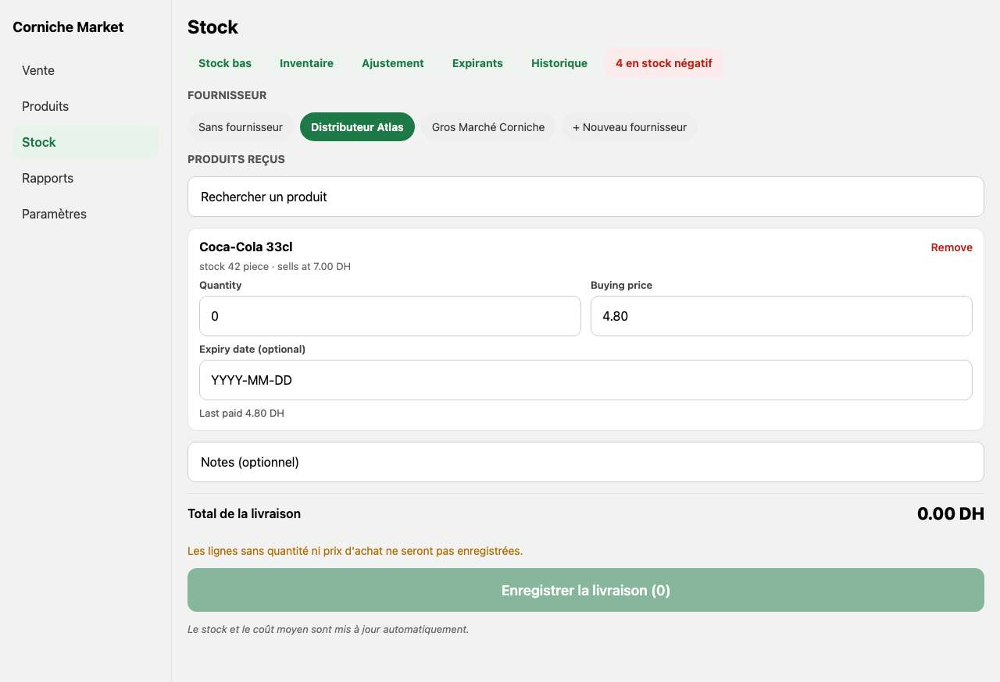

**Problem.** `BigButton`'s disabled state is `opacity: 0.5` on the whole button, text included. For the primary (green) and danger (red) variants that composites white text onto a pale wash of the brand color, at **2.1:1 contrast** — WCAG AA needs 4.5:1 for normal text, 3:1 even for large bold text, so this fails both. It's not a one-off: this is the button component itself, so it's wrong on "Enregistrer la livraison" when a delivery line is incomplete, "Enregistrer l'ajustement" at zero delta, "Encaisser la vente" on a short cash payment, and every other disabled primary/danger button in the app. A cashier glancing at the counter in bright daylight — exactly the condition the review brief calls out — cannot read *why* the button won't go, because the label is nearly invisible, not just greyed.
**Fix (quick win).** Don't dim the label. Keep a solid, slightly muted background (e.g. `#9fb9ab` for primary) and keep the text `#fff` at full opacity — or swap to a neutral grey background (`#d0d0d0`) with dark text (`#5a5a5a`), which is the more common disabled pattern and trivially passes contrast. One change in `BigButton.tsx`, fixes every screen at once.

### 2. Ten screen titles, four adjustment reasons, and two modals are in English — in French and Arabic mode

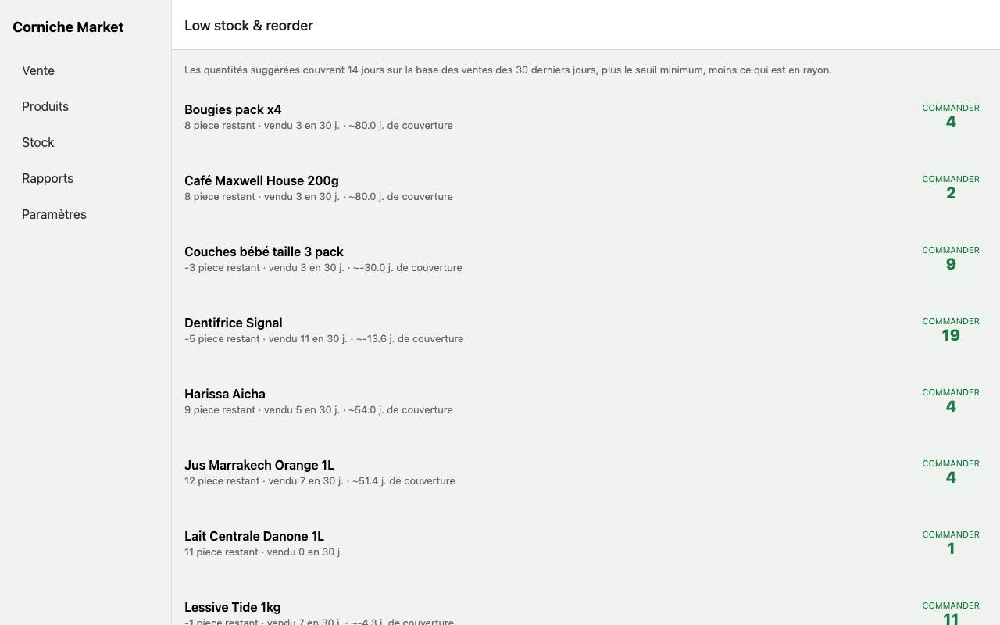
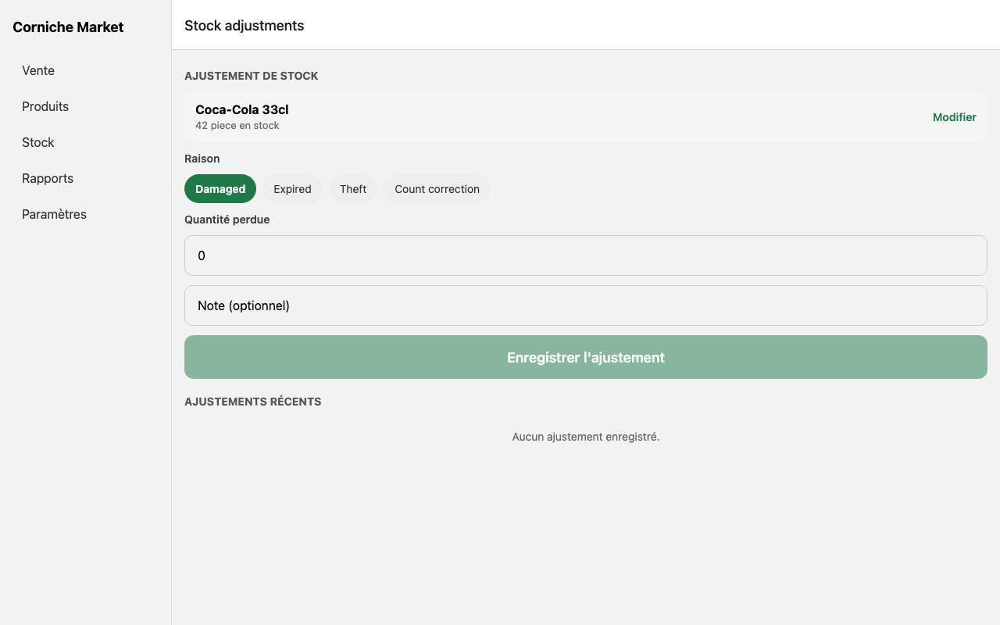

**Problem.** The app has full i18n infrastructure (`t()`, three complete language files, RTL), and almost every screen uses it — but ten `Stack.Screen` headers are literal English strings, not `t(...)`: "Purchase history", "Low stock & reorder", "Stock adjustments", "Stock count", "Expiring soon", "Negative stock", "New product", "Edit product", "Import products", "Buying price history" (`app/(app)/stock-in/_layout.tsx`, `app/(app)/products/_layout.tsx`). Open any of those in Arabic and the header bar reads left-to-right English above a right-to-left Arabic page. The four stock-adjustment reasons — "Damaged", "Expired", "Theft", "Count correction" — are hardcoded in `ADJUSTMENT_REASONS` and shown as chips on the Adjust screen regardless of language. `StockInLine` ("Quantity", "Buying price", "Expiry date (optional)", "Remove"), `BulkPriceModal` ("Change selling prices", "Category", "Percent change"), `ProductSearchPicker` ("Scan"), and `BarcodeScannerModal` ("Allow camera", "Cancel") are the same pattern. This isn't a translation gap at the edges — it's half the Stock In and Products chrome.
**Fix.** Add the missing keys to `fr.ts`/`en.ts`/`ar.ts` (TypeScript will enforce all three) and swap the literals for `t()`. A day of mechanical work, screen by screen; no design decision needed. `docs/SELL-GRID-DESIGN.md` step 0d already schedules this for the *Sell* screen's remaining strings — this is the same job for Stock In and Products, which that plan doesn't cover.

### 3. The weight-entry keypad clips at the bottom on the counter's own screen size

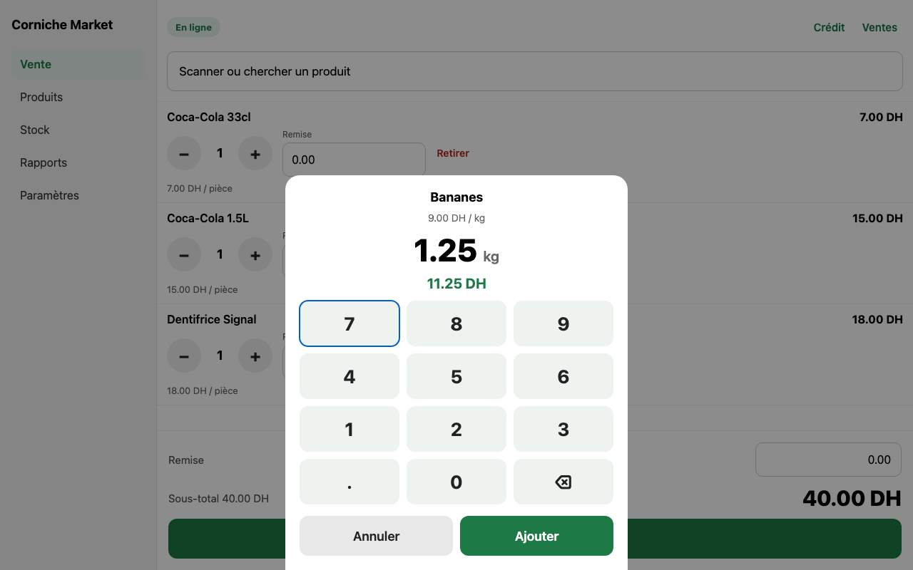

**Problem.** `docs/SELL-GRID-DESIGN.md` names 1280×800 as the primary counter device. Captured at exactly that size with no browser chrome, the weight-pad modal's "Ajouter" confirm button sits at y≈750 of an 800px-tall viewport — an 18 px margin. Any real device (browser toolbar, OS taskbar, a laptop at a slightly lower resolution) pushes that below the fold, and the keypad has no scroll affordance, so a cashier weighing produce can be stuck unable to reach "Ajouter" or "Annuler" without fiddling with zoom.
**Fix.** Cap the modal's max-height to the viewport and make its content scrollable, or shrink the keypad's vertical padding on short viewports. Small, contained change in `WeightPad.tsx`.

### 4. Network errors surface as a raw JavaScript string, inconsistently, screen by screen

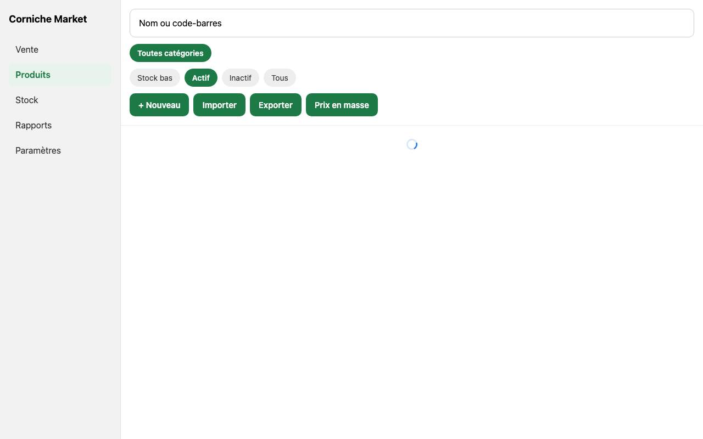

**Problem.** When a request fails, most screens eventually show `error.message` directly: `TypeError: Failed to fetch` on Products, Stock-in history, Sell history, Credit, Low-stock — untranslated, meaningless to a non-technical owner, identical in French and Arabic mode. It's not instant either: the screen sits on a bare spinner for several seconds first with no "still trying" feedback, then the raw string appears next to an otherwise-empty list. The one screen that gets this right is the **root auth guard** (profile fetch failure): a translated heading, a plain-language subtitle, and a "Réessayer" button — proving the pattern already exists, it's just not reused.
**Fix.** One shared `<LoadQueryError onRetry={...}>` component using the root guard's existing copy pattern ("Impossible de charger X" + Réessayer), swapped in wherever `{error && <Text>{error}</Text>}` appears today. Medium: touches ~6 screens, but each change is mechanical once the component exists.

### 5. Only the Sell screen tells you whether you're online

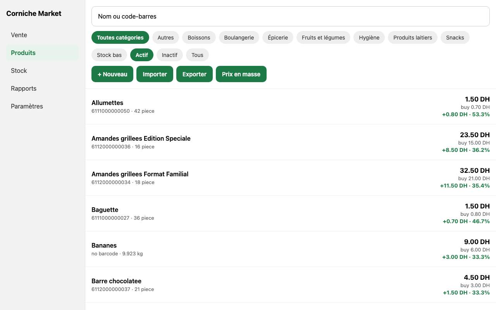

**Problem.** The green "En ligne" pill lives only in the Sell header. Products, Stock In, Reports, Settings show nothing — a cashier or owner on a flaky connection gets no warning before trying to receive a delivery or run a report, and (per #4) the eventual failure is a raw error string, not a "you're offline" message. Receiving stock is exactly the workflow where silently losing connectivity mid-task is costly.
**Fix.** Lift the existing online/offline hook one level, into the shared header/sidebar, so the indicator is global instead of Sell-only. Medium — touches the layout shell, not each screen.

### 6. A brand-new store (0 products) gives the owner an empty search box and nothing else

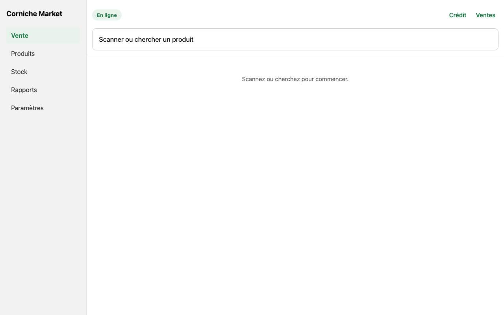

**Problem.** Production starts empty. The first thing a freshly-signed-in owner sees is the Sell screen: "Scannez ou cherchez pour commencer" over a blank list — no prompt to go add a product first, no link to Products, nothing that says what to do next. Products' own empty state ("Aucun produit ne correspond") is at least honest, but it's one tap away, not the landing screen, and still offers no "add your first product" call to action beyond the same toolbar button every other visit shows.
**Fix.** A one-time banner or empty-state card on first login with 0 products: "Commencez par ajouter vos produits" linking straight to Products → New (or Import). Quick win, high first-impression value — this is literally day-one for the real store.

### 7. Sign-in: Enter does nothing, and a wrong password's error is in English regardless of app language

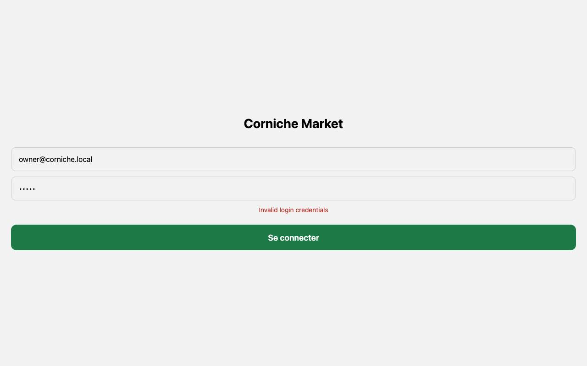

**Problem.** On web, pressing Enter in the password field does not submit — you must click "Se connecter". Every multi-user handoff at a shared counter pays this tax. Separately, a failed sign-in shows Supabase's raw message, "Invalid login credentials" — in English even when the UI around it is in Arabic (`sign-in.tsx` doesn't map the auth error through `t()`).
**Fix.** Both are quick wins: wrap the form in a `<form onSubmit>` (or add an `onSubmitEditing` handler) so Enter submits, and map the two or three Supabase auth error codes to translated strings with a generic fallback.

### 8. Destructive actions are one tap from a text field, with no second confirmation

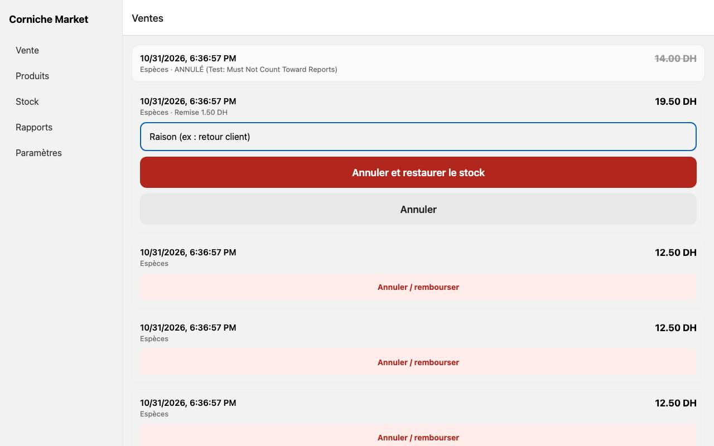

**Problem.** "Annuler et restaurer le stock" (void + restock) is a full-width red button sitting directly under a reason text field — one tap, no "are you sure?", no distinction between a light tap and a deliberate press. Stock adjustments (loss write-offs) are the same: pick a reason, type a number, one tap to commit, no confirmation. These are the two actions in the app that move real inventory and money backward; a mis-tap (easy on a touch counter mid-rush) is not recoverable by the cashier themselves.
**Fix.** A lightweight confirm step — press-and-hold, a second "Confirmer" tap, or a native confirm dialog on web — on void and on adjustments above a threshold (e.g. loss value > 50 DH). Quick win per screen.

### 9. Phone layout: the sidebar eats 61% of a 360px screen on every page

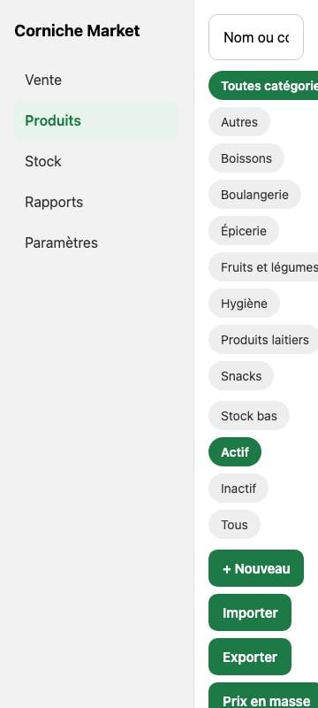

**Problem.** The same fixed 220px sidebar used on tablet/desktop renders on phone too (`app/(app)/_layout.tsx` uses the web sidebar layout at any width on web, and the full nav list + labels on native). At 360px wide that's 61% of the screen gone to navigation before any content shows — product rows, the cart, report tables all render in the remaining 140px, wrapping barcodes and prices awkwardly. Phone is a secondary target (the counter device is the tablet), but Settings and quick lookups on a personal phone are a real use case, and today they're nearly unusable.
**Fix.** Collapse the sidebar to a hamburger/bottom-tab under ~600px width, matching what `docs/SELL-GRID-DESIGN.md` §2.7.2 already calls for on the Sell screen specifically (sidebar → menu button below 900dp). This review asks for the same collapse on the other four sections, which that plan doesn't cover. Medium: one shared layout change.

### 10. No shared design tokens: 43 colors, 17 font sizes, 10 corner radii, 12 paddings, hand-typed per screen

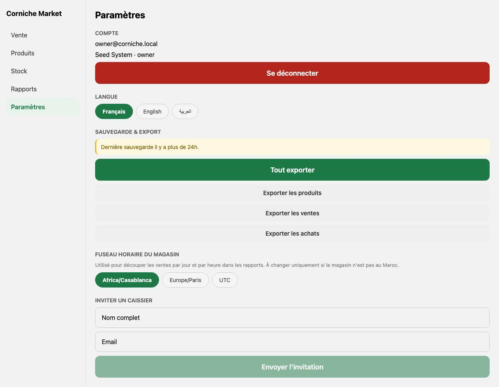

**Problem.** Grepping every `.tsx` under `app/` and `src/` turns up **43 distinct hex colors**, **17 distinct `fontSize` values** (10 through 44, no clear scale), **10 distinct `borderRadius` values**, and **12 distinct padding values** — all typed by hand per file, with no shared theme/constants module (`find src -iname "theme*"` returns nothing). The result is small, constant drift: card radii of 10, 12, 14, 16, 18, 20 doing the same job in different files; greys `#666`/`#777`/`#888`/`#999` used interchangeably for secondary text with no rule for which; button/chip heights that are "close to 48dp" rather than exactly a shared constant. None of it is a single dramatic bug — it's why the app reads as assembled screen-by-screen rather than one product. The Design System section below is the concrete fix.
**Fix.** Larger, cross-cutting: a `src/theme.ts` with the palette/scale below, then a screen-by-screen pass replacing literals with tokens. See the Build Plan.

---

## Full findings by screen

Tags: **Before launch** / **Soon after** / **Nice to have** — and **Quick win** (<1h) or **Larger**.

### Sign-in (`app/sign-in.tsx`)
- Enter key doesn't submit on web. — *Before launch, Quick win* (Top 10 #7)
- Auth error message not translated. — *Before launch, Quick win* (Top 10 #7)
- No "forgot password" path — a locked-out owner has no self-service recovery. — *Soon after, Larger* (needs a Supabase-side flow, not just UI)
- Centered card on a full-bleed grey background is clean and consistent with the rest of the app; no complaint here.

### Sell (`app/(app)/sell/*`)
Touch targets, hierarchy and RTL on this specific screen are already covered in depth by `docs/SELL-GRID-DESIGN.md` (§1.1–1.3, 2.7). Not re-litigated here; cross-references only.
- Weight-pad keypad clips on the primary counter viewport. — *Before launch, Quick win* (Top 10 #3)
- Cash-payment quick-amount chips ("49.00 / 50.00 / 100.00 / 200.00") are a nice touch — fast, correctly localized to MAD notes, good example to follow elsewhere.
- `sell/history.tsx`: the void reason field and the red "Annuler et restaurer le stock" button sit directly adjacent with no confirmation step. — *Before launch, Quick win* (Top 10 #8)
- `sell/history.tsx`: no date range or search on a screen that will eventually hold months of sales — today's list is unpaged beyond what loads once. — *Soon after, Larger*
- `sell/credit.tsx`: clear, well-prioritized (total owed at top, red for unpaid, "Soldé" customers demoted to a quiet list at the bottom) — good hierarchy, no complaint.
- `sell/stuck.tsx`: in every capture across all viewports/languages this screen never rendered — it always redirects to Sell via `router.replace` before paint (`Attempted to navigate before mounting the Root Layout`). Possibly correct behavior when there are no stuck sales to show, but it means this recovery screen is effectively unreachable and unverifiable from the outside; worth a second look by whoever owns the offline-queue code. — *Soon after, Larger*
- Offline banner only exists here, not elsewhere. — *Before launch, Larger* (Top 10 #5)

### Products (`app/(app)/products/*`)
- List rows are dense, well-aligned, scan quickly: name, barcode/stock meta, price, cost, margin, each on a consistent grid. No complaint on the list itself.
- Sub-screen titles in English ("New product", "Edit product", "Import products", "Buying price history"). — *Before launch, Quick win* (Top 10 #2)
- `BulkPriceModal`: "Change selling prices", "Category", "Percent change" labels and the "e.g. 5 or -10" placeholder are all hardcoded English. — *Before launch, Quick win* (Top 10 #2)
- `ProductSearchPicker`: "Scan" button label hardcoded. — *Before launch, Quick win* (Top 10 #2)
- `BarcodeScannerModal`: "Allow camera" / "Cancel" hardcoded. — *Before launch, Quick win* (Top 10 #2)
- Product edit form: "Stock et prix d'achat se modifient dans Stock, pas ici" is a genuinely good inline explanation of a non-obvious rule (why cost/stock fields aren't here) — keep this pattern, use it elsewhere RLS or triggers make something read-only.
- Raw `TypeError: Failed to fetch` on load failure. — *Before launch, Quick win once the shared component exists* (Top 10 #4)
- No "last synced" or "showing cached data" indicator when the product cache (used for offline barcode lookup) is stale — a cashier can't tell if a price shown offline is current. — *Soon after, Larger*

### Stock In (`app/(app)/stock-in/*`)
- Six sub-screen titles in English (Purchase history, Low stock & reorder, Stock adjustments, Stock count, Expiring soon, Negative stock). — *Before launch, Quick win* (Top 10 #2)
- `StockInLine`: "Quantity", "Buying price", "Expiry date (optional)", "Remove" all hardcoded. — *Before launch, Quick win* (Top 10 #2)
- Adjustment reasons ("Damaged", "Expired", "Theft", "Count correction") hardcoded. — *Before launch, Quick win* (Top 10 #2)
- Receive-delivery save button, disabled while a line is incomplete, is nearly unreadable (Top 10 #1).
- No confirmation before committing a stock adjustment. — *Before launch, Quick win* (Top 10 #8)
- Negative-stock screen's loss value (`stock_quantity * current_cost_cents`, no `Math.round`) can render a fractional-centime figure for weighed products — breaks the project's own "money is always integer centimes" rule from `CLAUDE.md`, visually (e.g. "−186.00 DH" is fine, but a kg product with a non-integer quantity won't always round to whole centimes before display). — *Soon after, Quick win* (use the existing `lineTotalCents`/`formatMAD` pipeline instead of a raw multiply)
- Expiring-soon empty state ("Rien n'expire…") and its "coût utilise une moyenne pondérée" footnote are clear, appropriately quiet.
- `count.tsx` intentionally untouched — Codex's T02 branch owns it; not reviewed here.

### Reports (`app/(app)/reports/*`)
- Dense but genuinely well-organized: today's headline numbers, then daily trend, by-category, by-hour, inventory value, then four ranked tables, then export — a sensible top-to-bottom priority order for a single long screen.
- Revenue and gross profit are both styled "large" (24px bold) with profit additionally colored green — they read as co-equal, not profit-first, even though profit is what the review brief (and most owners) would call the number that matters most. — *Soon after, Quick win* (bump profit's font size or add a card treatment to separate it from the rest of the metric row)
- Charts have no axis gridlines or tick marks beyond the printed value labels above each bar — readable at a glance for a handful of bars, would degrade with more categories/hours.
- Raw error string on load failure, same as other screens. — *Before launch, Quick win once shared*
- No offline indicator. — *Before launch, Larger* (Top 10 #5)
- CSV/PDF export buttons are clearly placed at the very bottom after a long scroll — fine for an owner reviewing results, but on phone this is a very long scroll to reach export. — *Nice to have*

### Settings (`app/(app)/settings.tsx`)
- Clear sectioning (Account / Language / Backup & Export / Timezone / Invite), good use of an amber warning banner for "last backup >24h ago."
- Cashier's Settings is appropriately minimal — just account info and language, no owner-only sections leak through. Confirmed no cost/profit/backup controls visible as cashier.
- Language switch shows a native `Alert.alert` ("restart required") on web, where `Alert.alert` renders as a browser-native blocking dialog, which looks and feels out of place next to the app's own styled modals (payment sheet, bulk price). — *Soon after, Quick win* (use the app's own modal/toast pattern instead of `Alert.alert` on web)
- Invite-cashier form has no loading state distinct from the submit button's own "Envoi..." label — acceptable, not a problem.

### Navigation / shell (5-section structure)
- Vente / Produits / Stock / Rapports / Paramètres is the right five for this job — maps directly to what a cashier vs. owner actually does, and matches the mental model CLAUDE.md describes. No restructuring needed.
- A new cashier could plausibly find Sell and Settings without training; Stock In's sub-navigation (five text links in a row: Stock bas / Inventaire / Ajustement / Expirants / Historique) is less discoverable — small text links with no icons or grouping, and a cashier never sees this row at all (the whole tab is owner-only, re: #1.3 below) which is a mismatch with CLAUDE.md's description of cashiers doing "stock receiving."
- Sidebar doesn't collapse on narrow web widths. — *Before launch, Larger* (Top 10 #9)
- **Role mismatch, worth flagging even though it's not strictly "UI":** `CLAUDE.md` says cashiers do "sales and stock receiving," but `stock-in/index.tsx` blocks any non-owner from the entire tab before rendering anything — Low stock, Expiring and Negative stock (all cost-free, cashier-safe reads) are unreachable too. This is a product decision, not a visual one, but it directly shapes the "can a new cashier find things" question the brief asks.

---

## Design system proposal

A starting point, not a redesign — it formalizes what's already mostly in use (the green, the card style) and fills the gaps (no type scale, no spacing scale, inconsistent radii). Doesn't touch the Sell grid's own 8-color tile palette (`docs/SELL-GRID-DESIGN.md` §9), which is a separate, data-driven system for per-product tile colors and can keep using these same brand/neutral tokens underneath it.

### Color
All pairs below checked against WCAG 2.1 (4.5:1 normal text, 3:1 large/bold text ≥ 19px or UI components).

| Token | Hex | Use | On white | On `bg` (#f2f2f2) |
|---|---|---|---|---|
| `brand.600` (primary) | `#1d7a46` | Primary buttons, active nav, links, positive values | 5.35:1 ✅ | 4.77:1 ✅ |
| `brand.100` | `#eef3ef` | Selected chip background, info cards | — | — |
| `danger.600` | `#b3261e` | Destructive buttons, errors, negative values | 6.54:1 ✅ | 5.72:1 ✅ |
| `danger.100` | `#fdecea` | Error/void row backgrounds | — | — |
| `warning.700` | `#8a5a00` *(darkened from today's `#b36b00`)* | Warning text on light backgrounds | 5.9:1 ✅ | 5.2:1 ✅ |
| `warning.100` | `#fff6e5` | Warning card background | — | — |
| `ink.900` | `#1a1a1a` | Primary text | 17.9:1 ✅ | 15.9:1 ✅ |
| `ink.600` *(replaces `#666`/`#777`/`#888`)* | `#5c5c5c` | Secondary text, meta | 6.0:1 ✅ | 5.3:1 ✅ |
| `ink.400` | `#8a8a8a` | Disabled text, placeholders (never for information that matters) | 3.0:1 ⚠️ large-only | — |
| `bg` | `#f2f2f2` | App/sidebar background | — | — |
| `surface` | `#ffffff` | Cards, inputs, sheets | — | — |
| `border` | `#d8d8d8` | Input/card borders | — | — |

**Changes from today's values, with why:**
- `#666`/`#777`/`#888`/`#999` collapse to one `ink.600` (`#5c5c5c`). Today's `#888` on the grey app background is 3.17:1 (fails normal-text AA); `#999` on white is 2.85:1 (fails even large-text AA). One darker grey fixes both and removes the "which grey do I use" question per file.
- The amber warning (`#b36b00` on `#f2f2f2`, used for e.g. the incomplete-delivery-lines notice) is 3.74:1 — fails normal-text AA. `#8a5a00` passes comfortably at the same hue.
- Disabled buttons stop using opacity (see Top 10 #1): `ink.400`-on-`border` or a dedicated muted brand tone with full-opacity text.

### Type scale
Replace the current 17 ad-hoc sizes with six:

| Token | Size | Weight | Use |
|---|---|---|---|
| `display` | 28 | 800 | Screen-level KPI (today's revenue, sign-in title) |
| `title` | 22 | 700 | Screen titles, section headers |
| `subtitle` | 17 | 700 | Card/row titles (product name, supplier name) |
| `body` | 15 | 400/600 | Default text, button labels |
| `caption` | 13 | 500 | Meta text, table labels, timestamps |
| `micro` | 11 | 600, uppercase | Section eyebrows ("RÉSULTATS — AUJOURD'HUI") |

### Spacing scale
Base-4, replacing the current scattered 6/8/10/12/14/15/16/18/20/22/24/32: **4, 8, 12, 16, 24, 32.** Card/section padding standardizes on 16; gaps between stacked elements on 8 or 12; screen-edge padding on 16 (phone) / 24 (tablet+).

### Radius
Two values, not ten: **10** for inputs/buttons/chips, **16** for cards/sheets/modals.

### Components
- **Button** (already close): 56dp min height, radius 10, `body` weight 600. Primary = `brand.600`/white. Secondary = `border`-bordered/`ink.900`. Danger = `danger.600`/white. Disabled = solid `#e0e0e0`/`ink.600` text (not opacity).
- **Card**: `surface`, radius 16, padding 16, no border (shadow-free flat style already used consistently — keep it, it suits a bright-light counter screen better than subtle shadows would).
- **Chip** (category/supplier/reason filters): radius 20 (pill), `bg`/`ink.900` default, `brand.600`/white selected — already the pattern in most places, just needs the few hardcoded-English ones brought in line.
- **Input**: 52–56dp height, radius 10, `border` 1px, 16px horizontal padding — already consistent; no change needed, just codify it.

---

## Build plan — small PRs, quick wins first

1. **Disabled-button contrast fix.** `BigButton.tsx` disabled style. (Top 10 #1) — *Quick win*
2. **Sign-in: Enter submits, auth error translated.** (Top 10 #7) — *Quick win*
3. **Theme module.** `src/theme.ts` with the palette/scale above; no screen migrated yet, just the source of truth created. — *Quick win*
4. **Stock In + Products i18n sweep.** Ten screen titles, four adjustment reasons, `StockInLine`, `BulkPriceModal`, `ProductSearchPicker`, `BarcodeScannerModal` — add keys to all three language files, swap literals for `t()`. (Top 10 #2) — *Larger but mechanical, can split into 2–3 PRs by screen group*
5. **Shared error-state component + retry**, adopted on Products, Stock-in history, Sell history, Credit, Low-stock, Reports. (Top 10 #4) — *Larger*
6. **Confirm step on void and on stock adjustments.** (Top 10 #8) — *Quick win per screen, do together*
7. **Weight-pad modal max-height/scroll fix.** (Top 10 #3) — *Quick win*
8. **Negative-stock loss value rounding** (use `lineTotalCents`). — *Quick win*
9. **Global offline indicator** in the shared header, replacing the Sell-only one. (Top 10 #5) — *Larger*
10. **Sidebar collapse below ~600px**, shared layout change covering Products/Stock/Reports/Settings (Sell's own collapse is already scheduled in the grid plan). (Top 10 #9) — *Larger*
11. **Empty-store onboarding banner** on Sell when the catalog is empty. (Top 10 #6) — *Quick win*
12. **Settings: replace web `Alert.alert` with the app's own modal.** — *Quick win*
13. **Reports: give gross profit clearer visual priority over revenue.** — *Quick win*
14. **Token migration pass**, screen by screen, replacing literal colors/sizes/radii/spacing with the theme module from PR 3 — the long tail that makes the app read as one product. Split per section (Sell already partly covered by the grid rebuild; Products; Stock In; Reports; Settings) to keep each PR reviewable. — *Larger, ongoing*

PRs 1, 2, 6, 7, 8, 11, 12, 13 need no design decision and can land immediately. PR 4 is the single biggest localization gap in the app today and should go out before PR 10/14, which will touch the same files. PR 9 and 10 touch the shared layout shell, so they're worth sequencing back-to-back to avoid two separate reviews of the same file.
